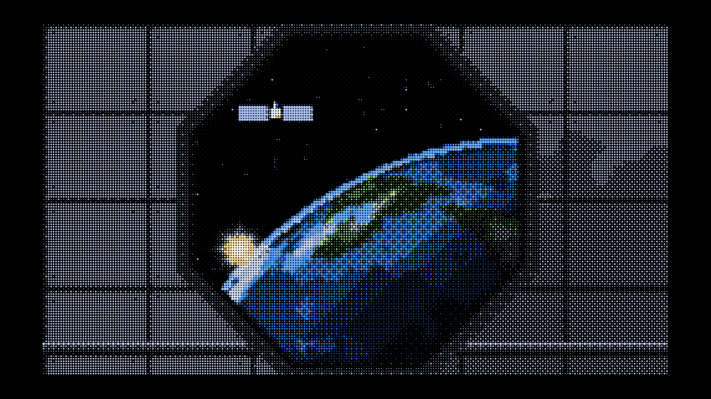

<div align="center">
  
</div>

<br />

<div align="center">
  <a href="https://portafolio-jose-ten.vercel.app/">
    
  </a>
  <a href="https://github.com/Jose-langL?tab=repositories">
    
  </a>
  
</div>

<h1 align="center">Hola, soy Jose Luis Tot Herrera</h1>

<p align="center">
  <strong>Técnico en Desarrollo en Software</strong>
  <br />
 Me gusta aprender, experimentar y transformar ideas en proyectos mediante la programación. Actualmente me enfoco en fortalecer mis conocimientos en desarrollo de software, explorar nuevas herramientas y asumir retos que me permitan seguir creciendo.
</p>

<div align="center">
  <a href="https://github.com/Jose-langL">
    
  </a>
</div>

---

## Que hago

<table>
  <tr>
    <td width="50%">
      <h3>Desarrollo de Software</h3>
      <p>Me interesa la creación de soluciones digitales, principalmente en el desarrollo web, buscando transformar ideas en aplicaciones funcionales y explorar nuevas áreas de la programación.</p>
    </td>
    <td width="50%">
      <h3>Proyectos y soluciones</h3>
      <p>Desarrollo proyectos académicos y personales, convirtiendo conocimientos teóricos en soluciones prácticas y funcionales.</p>
    </td>
  </tr>
  <tr>
    <td width="50%">
      <h3>Trabajo tecnico</h3>
      <p>Me enfoco en escribir código organizado, aplicar buenas prácticas de programación y mantener una estructura clara en mis proyectos.</p>
      <p> Git · GitHub · Documentación.</p>
    </td>
    <td width="50%">
      <h3>Aprendizaje continuo</h3>
      <p>Me gusta experimentar, explorar nuevas herramientas y enfrentar diferentes retos que me permitan adquirir conocimientos y fortalecer mis habilidades como desarrollador.</p>
    </td>
  </tr>
</table>

---

## Stack principal

<div align="center">
  
</div>

<br />

<div align="center">
  
  
  
  
</div>

## Proyectos destacados

<table>
  <tr>
    <td width="33%">
      <h3>Sistema de Parqueo</h3>
      <p>Aplicación web para administrar espacios de parqueo, registrar vehículos y calcular pagos
      </p>
      <p><strong>Stack:</strong>HTML, CSS, JavaScript</p>
      <a href="https://github.com/Jose-langL/Proyecto_JavaScript_HerreraJoseLuis.git">Ver proyecto</a>
    </td>
    <td width="33%">
      <h3>Gestion de Hotel</h3>
      <p>Aplicacion web para administrar las habitaciones de un hotel, registrar habitacion y estado de las habitaciones.</p>
      <p><strong>Stack:</strong> HTML, CSS, JavaScript</p>
      <a href="https://github.com/Jose-langL/Gesti-n-del-hotel.git">Ver proyecto</a>
    </td>
    <td width="33%">
      <h3>Api Dragon Ball</h3>
      <p>Una pagina web donde hacemos una extraccion de datos base una api de dragon ball</p>
      <p><strong>Stack:</strong> HTML, CSS, Javascript</p>
      <a href="https://github.com/Jose-langL/Api-Dragon-Ball.git">Ver proyecto</a>
    </td>
  </tr>
</table>

---

## Actividad en GitHub

<div align="center">

</div>

<table>
  <tr>
    <td width="50%">
      
    </td>
    <td width="50%">
      
    </td>
  </tr>
</table>

<div align="center">
  
</div>

---

## Como trabajo

```txt
Analisis -> estructura -> desarrollo -> validacion -> documentacion -> mejora
```

<table>
  <tr>
    <td>Orden tecnico</td>
    <td>Me adapto rápidamente a nuevos retos y herramientas.</td>
  </tr>
  <tr>
    <td>Objetivo profesional</td>
    <td>Conseguir mi primera oportunidad como desarrollador junior para seguir creciendo profesionalmente y aportar soluciones mediante el desarrollo digital.</td>
  </tr>
</table>

---

## Contacto

<div align="center">
  <a href="https://www.linkedin.com/in/jose-luis-3a1300398/">
    
  </a>
  <a href="mailto:totherrerajoseluis@gmail.com">
    
  </a>
  <a href="https://github.com/Jose-langL">
    
  </a>
</div>

<br />

<div align="center">
  <strong> Disponible | Ciudad Guatemala, Guatemala</strong>
</div>

---
<a href="https://github.com/jose-langl">

</a>

<!-- Export the GIF below in the look you picked, commit it, then: -->
<p align="center">
  
</p>


